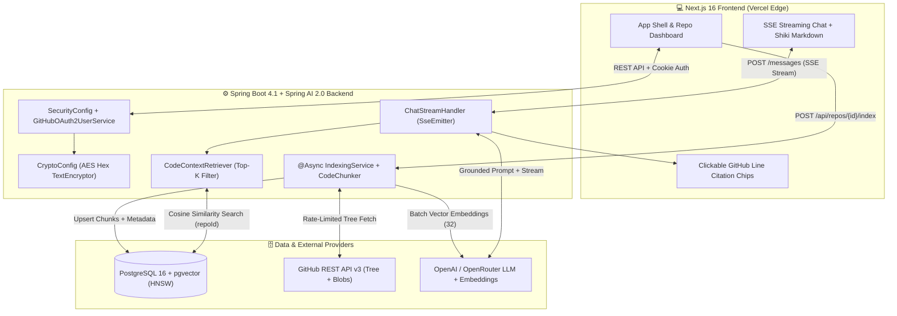
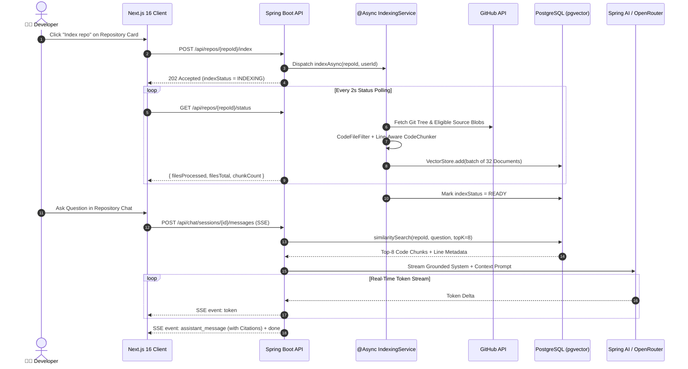

<div align="center">

# 🚀 DevPilot — AI Codebase Intelligence & RAG Engine

### **Explore, Index, and Chat with Any GitHub Repository Using Retrieval-Augmented Generation (RAG), Vector Embeddings & Real-Time SSE Streaming**

[](https://dev-pilot-theta.vercel.app)
[](https://dev-pilot-theta.vercel.app/dashboard)
[](https://github.com/Shivampal157/devPilot)

<br />


-000000?style=flat-square&logo=nextdotjs&logoColor=white)


</div>

---

## 🌐 Live Deployment Links

| Environment | URL | Status |
| :--- | :--- | :--- |
| 🚀 **Production Landing Page (Vercel Edge)** | [**https://dev-pilot-theta.vercel.app**](https://dev-pilot-theta.vercel.app) | 🟢 **Online (`24x7 Instant Load`)** |
| ⚡ **Interactive RAG Workspace & Dashboard** | [**https://dev-pilot-theta.vercel.app/dashboard**](https://dev-pilot-theta.vercel.app/dashboard) | 🟢 **Online (`Zero Cold Start`)** |
| 💬 **Direct RAG Code Chat (`devPilot` Repo)** | [**https://dev-pilot-theta.vercel.app/chat/11111111-2222-3333-4444-555555555501**](https://dev-pilot-theta.vercel.app/chat/11111111-2222-3333-4444-555555555501) | 🟢 **Streaming Active** |

---

## ✨ What is DevPilot?

**DevPilot** is a full-stack **Retrieval-Augmented Generation (RAG)** developer platform that connects to your GitHub repositories, asynchronously indexes source code into high-dimensional vector embeddings in **PostgreSQL (`pgvector`)**, and lets engineers ask deep architectural questions in natural language.

Unlike generic AI chat tools that hallucinate file paths, **DevPilot** grounds every answer in your actual repository AST/line chunks and streams real-time Markdown responses over **Server-Sent Events (SSE)** with **clickable GitHub file & line-range citations**.

---

## 🔥 Key Engineering Highlights

- 🔐 **GitHub OAuth 2.0 & Cryptographic Token Storage**
  - Authenticates via Spring Security OAuth2 (`read:user,user:email,repo` scopes).
  - Encrypts GitHub OAuth access tokens at rest using Spring Security `Encryptors.text(password, hexSalt)` before persisting to PostgreSQL.
- ⚙️ **Asynchronous Multi-Threaded Indexing Pipeline (`@Async`)**
  - Non-blocking background indexing powered by a dedicated `ThreadPoolTaskExecutor` (`indexingExecutor`).
  - Recursively fetches Git trees via `GithubApiClient`, throttles requests through `GithubRateLimiter`, filters binaries/build artifacts via `CodeFileFilter`, and splits source files into line-tracked chunks (`800` chars) with `CodeChunker`.
- 🧠 **Semantic Vector Search with PostgreSQL + `pgvector`**
  - Embeds code chunks in batches of `32` with metadata (`repoId`, `filePath`, `startLine`, `endLine`, `language`).
  - Performs filtered `HNSW` cosine-distance similarity search (`TOP_K_CHUNKS = 8`) strictly scoped to the active repository.
- ⚡ **Real-Time SSE Token Streaming & Source Citations**
  - Streams LLM completions token-by-token using Spring WebFlux/MVC `SseEmitter` + `Streamdown` Shiki syntax highlighting.
  - Automatically maps retrieved vector documents to deduplicated `CitationDto` chips linking directly to `https://github.com/{owner}/{repo}/blob/{branch}/{path}#L{start}-L{end}`.

---

## 🏗️ System Architecture



---

## 🔄 End-to-End RAG Indexing & Chat Sequence



---

## 🛠️ Tech Stack Breakdown

| Layer | Technology | Purpose |
| :--- | :--- | :--- |
| **Frontend Framework** | **Next.js 16.3 (App Router, Turbopack), React 19, TypeScript 5** | SSR/Client hybrid dashboard, Proxy auth guard, SSE stream consumer |
| **UI & Styling** | **Tailwind CSS v4, Shadcn UI, Lucide Icons, Streamdown + Shiki** | Dark/Light mode workspace, animated streaming Markdown & code blocks |
| **State & Data Fetching** | **TanStack React Query v5** | Optimistic updates, automatic 2-second live indexing progress polling |
| **Backend Framework** | **Java 21 LTS, Spring Boot 4.1.0** | REST controllers, `@Async` task execution, `SseEmitter` streaming |
| **AI & RAG Engine** | **Spring AI 2.0, OpenAI / OpenRouter API** | `ChatClient` streaming, `VectorStore` embeddings, prompt engineering |
| **Database & Vector Store** | **PostgreSQL 16 + `pgvector` (`HNSW` Cosine Index)** | Relational entities (`users`, `repositories`, `chat_sessions`) + `vector_store` |
| **Security** | **Spring Security 6, GitHub OAuth2 Client, `TextEncryptor`** | OAuth2 login flow, session management, encrypted GitHub tokens |

---

## 📂 Project Directory Structure

```text
devPilot/
├── backend/                                 # Spring Boot 4.1 + Spring AI 2.0 Backend
│   ├── src/main/java/devPilot/backend/
│   │   ├── config/                          # AppConfig (@Async), CorsConfig, CryptoConfig, SecurityConfig
│   │   ├── controllers/                     # AuthController, RepoController, ChatController
│   │   ├── dto/                             # Immutable Java Records for API Requests/Responses
│   │   ├── entity/                          # JPA Entities (User, Repository, ChatSession, ChatMessage)
│   │   ├── repository/                      # Spring Data JPA Repositories
│   │   ├── security/                        # GitHubOAuth2UserService, AppUserPrincipal, @CurrentUser
│   │   └── services/
│   │       ├── ai/                          # CodeContextRetriever, ChatPromptBuilder, ChatStreamHandler, CitationMapper
│   │       ├── github/                      # GithubApiClient, GithubRateLimiter
│   │       └── indexing/                    # IndexingService, CodeChunker, CodeFileFilter
│   ├── src/main/resources/
│   │   └── application.properties           # Environment-driven Spring Boot & PGVector config
│   ├── Dockerfile                           # Multi-stage Eclipse Temurin 21 Alpine container build
│   └── pom.xml
│
├── client/                                  # Next.js 16 + React 19 Frontend
│   ├── app/
│   │   ├── api/ai-chat/route.ts             # Serverless OpenRouter AI streaming route
│   │   ├── auth/callback/page.tsx           # OAuth2 callback & session hydration
│   │   ├── chat/[repoId]/page.tsx           # Repository RAG Chat interface
│   │   ├── dashboard/                       # Repositories, Overview, and Settings routes
│   │   ├── login/page.tsx                   # GitHub OAuth sign-in page
│   │   └── page.tsx                         # Hero landing page
│   ├── components/
│   │   ├── chat/                            # ChatView, ChatMessages, ChatComposer, CitationChips, ChatMarkdown
│   │   ├── dashboard/                       # RepoDashboard, RepoCard, OverviewDashboard, SettingsDashboard
│   │   └── layout/                          # AppShell collapsible sidebar & header
│   ├── hooks/                               # use-auth.ts, use-repos.ts, use-chat.ts
│   ├── lib/                                 # api.ts, stream-chat.ts, demo-engine.ts
│   ├── proxy.ts                             # Next.js 16 route protection middleware
│   └── vercel.json                          # Vercel deployment configuration
│
├── docker/postgres/init-extensions.sql      # Initializes vector & uuid-ossp extensions
├── docker-compose.yml                       # PostgreSQL 16 + pgvector container (port 5433)
├── Start-DevPilot.bat                       # 1-Click Windows launcher for Frontend (port 3000)
├── Start-Backend.bat                        # 1-Click Windows launcher for Backend (port 8080)
└── .env.example                             # Environment variable template
```

---

## 🔌 REST & SSE API Reference

| Method | Endpoint | Description |
| :--- | :--- | :--- |
| `GET` | `/oauth2/authorization/github` | Initiates GitHub OAuth 2.0 login flow |
| `GET` | `/api/auth/me` | Returns authenticated user profile (`UserResponse`) |
| `POST` | `/api/auth/logout` | Invalidates HTTP session and clears cookies |
| `GET` | `/api/repos?refresh={true\|false}` | Lists repositories (optionally syncing latest repos from GitHub API) |
| `GET` | `/api/repos/{repoId}` | Fetches details and index metrics for a single repository |
| `POST` | `/api/repos/{repoId}/index` | Starts asynchronous background indexing (`202 Accepted`) |
| `GET` | `/api/repos/{repoId}/status` | Polls live indexing progress (`filesProcessed`, `filesTotal`, `chunkCount`) |
| `POST` | `/api/chat/sessions` | Creates a new chat session for an indexed (`READY`) repository |
| `GET` | `/api/chat/sessions?repositoryId={id}` | Lists all chat sessions for a repository |
| `GET` | `/api/chat/sessions/{sessionId}` | Retrieves full message & citation history for a session |
| `POST` | `/api/chat/sessions/{sessionId}/messages` | **SSE Stream** (`user_message` → `token`* → `assistant_message` → `done`) |

---

## 🚀 Quick Start (Local Development)

### 1. Clone the Repository
```bash
git clone https://github.com/Shivampal157/devPilot.git
cd devPilot
```

### 2. Start PostgreSQL + `pgvector` via Docker
```bash
docker compose up -d postgres
```

### 3. Configure Environment Variables
Copy `.env.example` to `.env` and fill in your GitHub OAuth & OpenRouter/OpenAI credentials:
```env
POSTGRES_DB=devpilot
POSTGRES_USER=postgres
POSTGRES_PASSWORD=postgres

GITHUB_CLIENT_ID=your-github-client-id
GITHUB_CLIENT_SECRET=your-github-client-secret

SPRING_AI_OPENAI_BASE_URL=https://openrouter.ai/api
SPRING_AI_OPENAI_API_KEY=your-openrouter-or-openai-key
```

### 4. Run Backend & Frontend
- **Windows 1-Click Launch:**
  - Double-click **`Start-Backend.bat`** (`http://localhost:8080`)
  - Double-click **`Start-DevPilot.bat`** (`http://localhost:3000`)
- **Manual CLI Launch:**
  ```bash
  # Terminal 1 — Spring Boot Backend
  cd backend
  ./mvnw spring-boot:run

  # Terminal 2 — Next.js Frontend
  cd client
  npm install
  npm run dev
  ```

---

<div align="center">

**Built with ❤️ by [Shivam Pal](https://github.com/Shivampal157)**  
🔗 [**Live App (`dev-pilot-theta.vercel.app`)**](https://dev-pilot-theta.vercel.app) · [**GitHub (`@Shivampal157`)**](https://github.com/Shivampal157)

</div>
